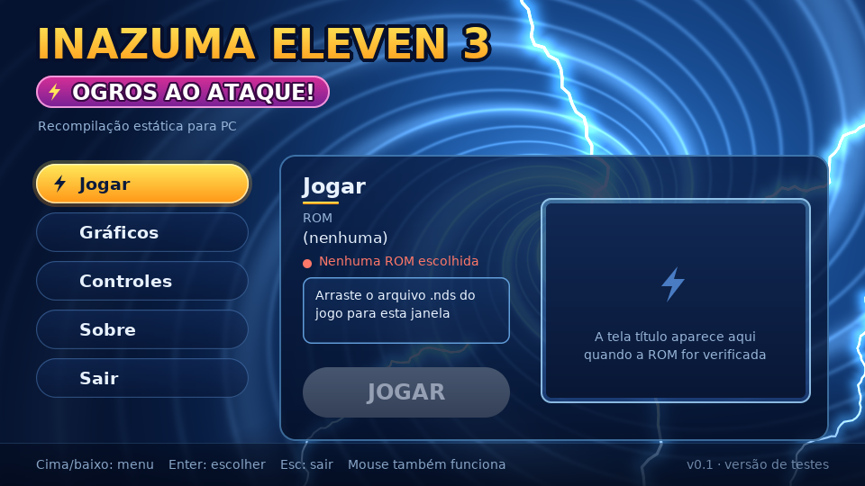
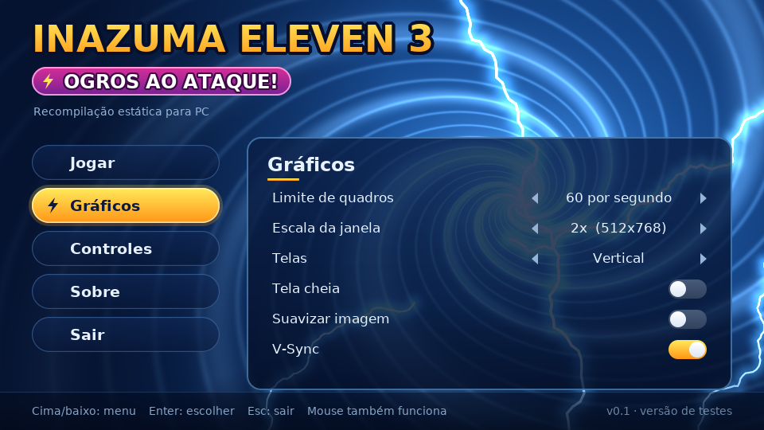
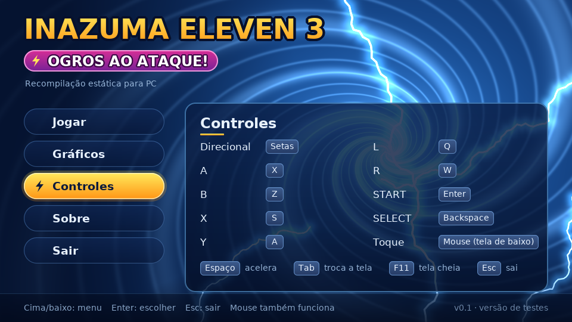
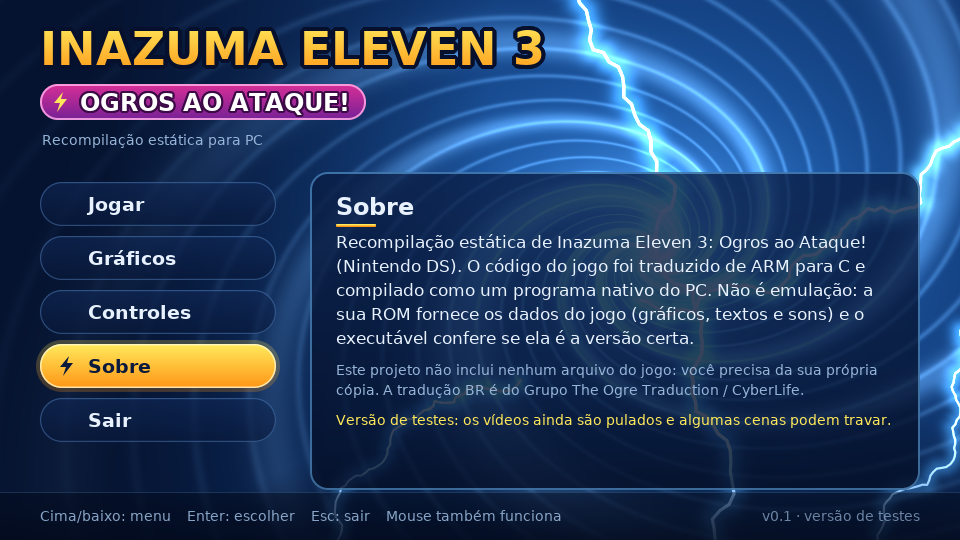

# Inazuma Eleven 3 Recomp

Recompilação estática de **Inazuma Eleven 3 - Sekai e no Chousen!! The Ogre** (Nintendo DS) para rodar nativamente no PC.

<a href="https://recomplauncher.com"><picture><source media="(prefers-color-scheme: dark)" srcset="https://recomplauncher.com/assets/press/launcher/badge-light.svg"></picture></a>

> Este repositório **não contém** a ROM nem arquivos do jogo. Você precisa da sua própria cópia.
> ROM de referência: `BOEJ`, tradução BR T1.3, SHA-1 `a70e9a336f6ea8ff78003938dcd024533f034a68`.

<p align="center">
  
  
  
  
</p>

## Status: versão de testes (v0.1)

**Quanto já foi recompilado**

| O quê | Situação |
|---|---|
| Código ARM do jogo (ARM9 + 133 overlays) | **18.655 funções, cerca de 957 mil instruções traduzidas para C** |
| Instruções que o tradutor ainda não cobre | 138 (0,01%; a maioria é dado confundido com código) |
| Funções Thumb | 142, rodam num interpretador pequeno |
| Processador ARM7 (som, toque, cartão) | substituído por HLE no runtime |
| Vídeos Mobiclip (decodificador escrito à mão em assembly) | tocam com imagem e som: esse trecho roda num interpretador ARM |

Ou seja, praticamente todo o código do jogo já vira C. O que falta está no **runtime** (a parte que imita o hardware do DS) e em casos especiais.

**Até onde o jogo vai**

- Funciona: créditos da tradução, tela título, novo jogo, teclado do nome do save, as primeiras cenas da história (Futuro, Rua) com conversas, vozes, música, mapa e o cenário 3D com o personagem andando, menu (bolsa), salvar e continuar do save, vídeos com som.
- A história passa da cena "voltando pro nosso tempo" (antes fechava).
- Ainda não tem: sombras e contorno no 3D. Há um glitch de espaçamento em alguns textos.

Detalhes técnicos em [docs/fase1.md](docs/fase1.md) (análise) e [docs/fase2.md](docs/fase2.md) (recompilador e runtime).

## Como compilar e jogar

O `ie3.exe` (ou `ie3` no Linux) contém o código do jogo traduzido para C, então ele é **gerado na sua máquina, a partir da sua ROM**. Por isso as releases trazem só o código e estas instruções.

### Linux

```bash
sudo apt install build-essential python3-pip libsdl2-dev
pip install -r requirements.txt
python3 -I tools/extract.py rom.nds extracted     # extrai o código da SUA ROM
make gen && make -j4 SDL=1
./build/ie3                                       # abre o launcher
./build/ie3 rom.nds --jogar                       # ou direto, sem o launcher
```

### Windows

- **No Windows, com MSYS2** (terminal "MSYS2 MINGW64"):
  ```bash
  pacman -S --needed make python python-pip mingw-w64-x86_64-gcc mingw-w64-x86_64-SDL2
  pip install capstone ndspy
  python -I tools/extract.py rom.nds extracted
  make gen && make -j4 WIN=1 CC=gcc SDL_DIR=/mingw64 EXE=.exe BUILD=build-win
  ```
- **No Linux, gerando para Windows** (MinGW + o pacote `SDL2-devel-<versão>-mingw.tar.gz` do SDL2):
  ```bash
  sudo apt install mingw-w64
  python3 -I tools/extract.py rom.nds extracted
  make gen && make windows -j4 SDL_DIR=<pasta do SDL2>/x86_64-w64-mingw32
  ```

O resultado fica em `build-win/` (`ie3.exe` e `SDL2.dll`). O `.exe` abre só a janela do jogo, sem console; as mensagens vão para `ie3recomp.log`, ao lado do `.exe`. Para ver o log ao vivo, compile com `WIN_CONSOLE=1`.
O `.exe` leva ícone, dados de versão (Propriedades > Detalhes) e manifesto (`win/`).

**Aviso do SmartScreen:** o SmartScreen só avisa em arquivos **baixados da internet** e sem assinatura digital. Um `.exe` que você mesmo compilou não tem essa marca e abre sem aviso. Se você copiar o `.exe` de outra pessoa, o Windows vai avisar, e o certo é não fazer isso (veja a nota legal abaixo). A única forma de tirar o aviso de um arquivo baixado é assinar com um certificado de código, o que não se aplica aqui porque o projeto não distribui executáveis.

### Com o RecompLauncher

O projeto traz um [`recomplauncher.json`](recomplauncher.json), e o build copia esse arquivo para `build/` e `build-win/`, ao lado do executável.
Como o executável é gerado na sua máquina, adicione a pasta pelo **Bring Your Recomps** (nas configurações do [RecompLauncher](https://github.com/elripalda/RecompLauncher)) e escolha **Keep untracked**: as releases deste projeto não têm executável para baixar.
Aí o RecompLauncher pede a sua ROM, mostra as opções de vídeo na página do jogo e começa o jogo direto, sem o launcher próprio. Tudo que o jogo escreve (save, `ie3recomp.ini` e o log em `logs/`) fica na pasta `recompdata` do jogo.

As opções que ele usa também funcionam sozinhas: `--game <rom>` (a ROM) e `--data <pasta>` (onde ficam save, configuração e log; sem ela, tudo fica como antes, ao lado do executável).
O jogo sai com o código 2 quando não consegue abrir a ROM.

### Launcher

O launcher segue o estilo dos launchers de recomp: menu lateral (Jogar, Gráficos, Controles, Sobre) e funciona com mouse ou teclado.
Na primeira vez ele pede a ROM: arraste o arquivo `.nds` para a janela (ou passe o caminho na linha de comando).
Ele confere se é a versão certa pelo SHA-1 e mostra a tela título do jogo, **gerada da sua ROM**: o launcher roda o próprio recomp sem janela até a tela título (`ie3 --capturar-titulo`) e guarda a imagem em `ie3_titulo_<sha>.ppm` ao lado do `.ini`. Nenhuma arte do jogo fica no repositório (as imagens acima são do launcher sem ROM).
As opções ficam em `ie3recomp.ini`:

| Opção | Chave no .ini | Valores |
|---|---|---|
| ROM | `rom` | caminho do `.nds` |
| Limite de quadros | `fps` | 30, 60, 120, 144 ou 0 (sem limite) |
| Escala da janela | `escala` | 1 a 6 (2 = 512x768 com as telas em pé) |
| Tela cheia | `tela_cheia` | 0 ou 1 (F11 alterna durante o jogo) |
| Telas | `layout` | `vertical`, `lado_a_lado` ou `so_cima` (Tab troca para a de baixo) |
| Suavizar imagem | `suavizar` | 0 (pixels nítidos) ou 1 |
| V-Sync | `vsync` | 0 ou 1 |

### Controles

| DS | Teclado |
|---|---|
| Direcional | setas |
| A / B / X / Y | X / Z / S / A |
| L / R | Q / W |
| START / SELECT | Enter / Backspace |
| Toque | mouse na tela de baixo |

Extras: **Espaço (segurar) acelera o jogo** (pula quadros, até uns 4x), Tab troca a tela no modo de uma tela só, F11 tela cheia. Para sair, feche a janela (Alt+F4).
Opções de linha de comando: `--fps`, `--escala`, `--tela-cheia`, `--config <arq>`, `--sem-janela` (testes); veja `./build/ie3 --help`.

O executável só lê a ROM que você fornece: o ARM9 vai para a memória comprimido, como no cartão, e o próprio código recompilado do jogo o descomprime; os overlays são lidos e descomprimidos direto da ROM.

## Nota legal

- Este é um projeto de fãs, sem fins lucrativos e sem ligação com a LEVEL-5 ou a Nintendo. Inazuma Eleven é marca da LEVEL-5.
- O repositório e as releases trazem **só ferramentas e código próprio** (recompilador, runtime, launcher). Nenhum arquivo do jogo, nenhum código do jogo traduzido e nenhum executável com o jogo dentro.
- Para jogar você precisa de uma cópia do jogo que seja sua, extraída do seu próprio cartucho. Não peça nem compartilhe ROMs ou executáveis gerados (o `.exe` gerado contém o código do jogo).
- O projeto não quebra proteção de cópia: lê a ROM do jeito que o próprio console leria.
- A tradução BR é do grupo The Ogre Traduction / CyberLife; os créditos dela aparecem no jogo.
- Isto é um resumo de boas práticas de projetos de recompilação, não orientação jurídica.

## Ferramentas de análise

```bash
pip install -r requirements.txt
python3 -I tools/extract.py caminho/para/rom.nds extracted   # extrai ARM9, ITCM/DTCM, overlays e ARM7
python3 -I tools/analyze.py extracted analysis/functions.json  # descobre funções
python3 -I tools/dis.py 02029c08 40                            # disassembla um endereço
OV=16 python3 -I tools/xref.py 020f129c                        # início da função e quem chama (OV escolhe o overlay)
make gen && make -j4                                           # gera o C e compila build/ie3
RECOMP_WATCHDOG=20 ./build/ie3 rom.nds --sem-janela            # roda sem janela (testes)
tools/iterate.sh rom.nds                                       # roda e corrige funções faltantes automaticamente
```

## Plano

| Fase | Objetivo | Situação |
|---|---|---|
| 0 | Extrair e mapear a ROM | feito |
| 1 | Análise: funções, loop principal, overlays, IRQ, IPC | feito |
| 2 | Recompilador ARM/Thumb → C + runtime 2D | feito |
| 3 | Todos os overlays, arquivos e saves | feito |
| 4 | GPU 3D, som (HLE do ARM7), vídeos Mobiclip, entrada | feito |
| 5 | Polimento: resolução maior, controles configuráveis, aceleração | começando (tecla de acelerar) |
